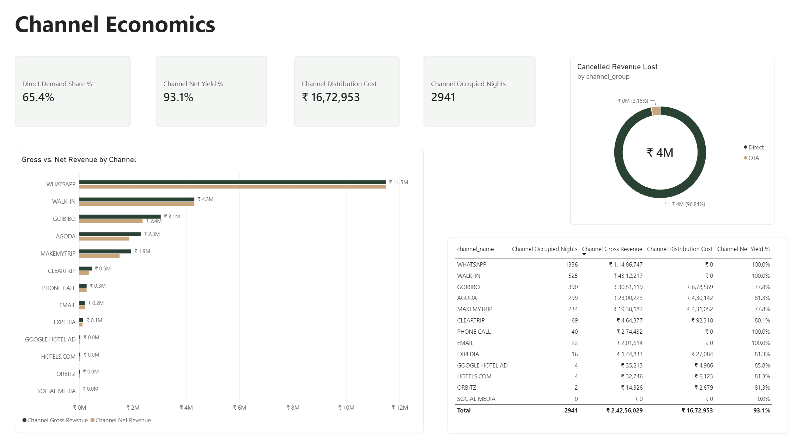

# Coorg Resort Revenue & Channel Performance Analytics (dbt + Power BI)

An end-to-end hospitality revenue management and channel profitability analytics pipeline built with **dbt**, **DuckDB**, **Python**, and **Power BI**. Designed around multi-channel resort operations in Coorg, Karnataka, this project transforms raw PMS reservations, room inventory, and OTA commission structures into an executive three-page Power BI semantic model.

---

## Key Business Findings & Strategic Recommendations

* **Strong Direct Demand Engine (`65.4%` Direct Share):** Direct channels—led by **WhatsApp (`₹1.15Cr` Gross)** and **Walk-In (`₹43.1L` Gross)**—drive nearly two-thirds of occupied room nights at **`100.0%` Net Yield** (`₹0` distribution cost).
* **OTA Commission & Cancellation Leakage:** Online Travel Agencies (Goibibo, Agoda, MakeMyTrip, Cleartrip) compress net yield to **`77%–81%`**, generating **`₹16,72,953`** in direct commission/GST/TDS distribution costs and accounting for over **`95%` of the `₹4.0M`** in cancelled room revenue lost.
  * *Recommendation:* Introduce direct-booking incentives (complimentary breakfast or early check-in via WhatsApp/website) for repeat OTA guests and enforce stricter deposit rules on high-commission OTA rate plans.
* **Weekday vs. Weekend Occupancy Gap (`31.8%` vs. `54.5%`):** Weekend stays achieve **`₹4,404` Net RevPAR** (`₹8,081` Net ADR) compared to **`₹2,356` Net RevPAR** (`₹7,408` Net ADR) on Sun–Thu nights.
  * *Recommendation:* Launch workcation packages and 3-night mid-week couple bundles during Shoulder and Monsoon seasons to lift weekday occupancy closer to `42%+`.
* **Lead-Time Cancellation Elasticity (`7.6%` vs. `38.7%`):** Last-minute bookings (`0–3 days` lead time) represent the highest booking volume (`752` reservations) with only a **`7.6%`** cancellation rate, whereas early-bird bookings (`31+ days`) cancel at **`38.7%`**.
  * *Recommendation:* Require non-refundable partial prepayments or automated 14-day pre-arrival reconfirmation workflows for reservations booked `30+` days in advance.

---

## Architecture & Data Model

```text
Raw PMS & OTA Exports ─▶ Staging (stg_*) ─▶ Star Schema Marts (dbt + DuckDB) ─▶ Power BI Semantic Model (_Measures)
```

### Data Pipeline Flow
1. **Raw PMS Ingestion (`src/01_ingest_and_anonymize.py`)**: Cleans multi-format reservation dates, inventory logs, and revenue ledgers into DuckDB tables.
2. **dbt Transformation (`dbt_project/`)**:
   * **Staging (`stg_bookings`, `stg_daily_inventory`)**: Normalizes booking identifiers, cleans rates, discounts, and room types.
   * **Intermediate (`int_booking_nights`)**: Explodes multi-night stays into daily night-level grains.
   * **Dimensions (`dim_date`, `dim_channel`, `dim_room_type`)**: Provides calendar seasonality (Peak, Shoulder, Monsoon), channel classifications, and room hierarchies.
   * **Marts & Facts**:
     * `fct_daily_property_kpi`: Property-level occupancy, sellable inventory, RevPAR, and gross/net ADR.
     * `fct_daily_room_performance`: Room-category level occupancy and revenue distribution.
     * `fct_channel_economics`: Channel net yields, OTA commission/tax leakage, and cancellation shares.
     * `fct_booking_lifecycle`: Lead time bands, cancellation propensity, and booking status.
3. **Audit & Anonymized Export (`src/02_audit_and_export.py`)**: Reconciles PMS vs. dbt metrics and generates privacy-safe portfolio CSVs for Power BI.
4. **Power BI Semantic Model (`powerbi/resort_revenue_dashboard.pbix`)**: Star schema with DAX measures, dynamic filtering, and custom Coorg luxury resort theme.

---

## Dashboard Overview (powerbi/resort_revenue_dashboard.pbix)

### Page 1: Executive Overview & Property Performance
Tracks high-level property health: Occupancy Rate, Gross vs. Net ADR, RevPAR, and seasonal pace.


### Page 2: Channel Economics & OTA Net Yield
Analyzes channel contribution, distribution cost drag (commissions + taxes), net yield efficiency, and revenue leakage from cancellations.


### Page 3: Room Category Performance & Lead Time Elasticity
Explores room-type occupancy distribution, booking lead times (0–3 days vs. 31+ days), and cancellation elasticity.


---

## Tech Stack & How to Run

### Tech Stack
* **Transformation & Testing:** dbt Core (`dbt-duckdb`), DuckDB
* **Data Processing & Scripting:** Python 3.10+, pandas
* **BI & Semantic Modeling:** Microsoft Power BI Desktop, DAX
* **Styling & Aesthetics:** Custom Power BI Theme (`powerbi/coorg_resort_theme.json`)

### How to Run

1. **Set Up Python Environment:**
   ```bash
   python -m venv .venv
   .venv\Scripts\activate  # Windows
   pip install -r requirements.txt
   ```

2. **Ingest & Transform Data with dbt:**
   ```bash
   cd dbt_project && dbt build
   ```

3. **Audit & Export Public Portfolio Marts:**
   ```bash
   python src/02_audit_and_export.py
   ```

4. **Launch the Power BI Dashboard:**
   * Open `powerbi/resort_revenue_dashboard.pbix` in Power BI Desktop.
   * Refresh data to load the latest DuckDB/CSV mart exports.
