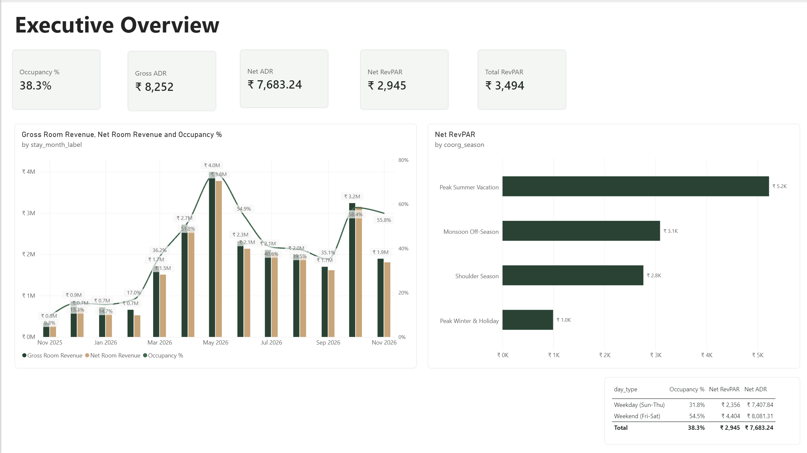

# Coorg Resort Revenue & Channel Performance Analytics (dbt + Power BI)

An end-to-end hospitality revenue management and channel profitability analytics pipeline built with **dbt**, **DuckDB**, **Python**, and **Power BI**. Designed around multi-channel resort operations in Coorg, Karnataka, this project transforms raw PMS reservations, room inventory, and OTA commission structures into an executive three-page Power BI semantic model.

---

## Key Business Findings & Strategic Recommendations

* **Strong Direct Demand Engine (`65.4%` Direct Share):** Direct channels—led by **WhatsApp (`₹1.15Cr` Gross)** and **Walk-In (`₹43.1L` Gross)**—drive nearly two-thirds of occupied room nights at **`100.0%` Net Yield** (`₹0` estimated distribution cost).
* **OTA Commission & Cancellation Drag:** Online Travel Agencies (Goibibo, Agoda, MakeMyTrip, Cleartrip) compress net yield to **`77.8%–81.3%`** (`79.04%` OTA blended average), generating **`₹16,72,953`** in estimated distribution costs (commissions, GST, and TDS) and accounting for over **`95%` of the `₹4.02M`** in cancelled booking value.
  * *Recommendation:* Introduce direct-booking incentives (complimentary breakfast or early check-in via WhatsApp/website) for repeat OTA guests and enforce stricter deposit rules on high-commission OTA rate plans.
* **Weekday vs. Weekend Occupancy Gap (`31.7%` vs. `54.5%`):** Weekend stays (Fri–Sat) achieve **`₹4,404` Net RevPAR** (`₹8,081` Net ADR) compared to **`₹2,351` Net RevPAR** (`₹7,409` Net ADR) on Sun–Thu nights—an **`87.3%` weekend RevPAR uplift**.
  * *Recommendation:* Launch workcation packages and 3-night mid-week couple bundles during Shoulder and Monsoon seasons to lift weekday occupancy closer to `42%+`.
* **Lead-Time Cancellation Elasticity (`7.6%` vs. `38.7%`):** Last-minute bookings (`0–3 days` lead time) represent the highest booking volume with only a **`7.6%`** cancellation rate, whereas early-bird bookings (`31+ days`) cancel at **`38.7%`**.
  * *Recommendation:* Require non-refundable partial prepayments or automated 14-day pre-arrival reconfirmation workflows for reservations booked `30+` days in advance.

---

## Architecture & Data Model

```text
Raw PMS & OTA Exports ─▶ Staging (stg_*) ─▶ Star Schema Marts (dbt + DuckDB) ─▶ Power BI Semantic Model (_Measures)
```

### Data Pipeline Flow
1. **Raw PMS Ingestion (`src/01_ingest_and_anonymize.py`)**: Cleans multi-format reservation dates, inventory logs, and revenue ledgers into DuckDB tables.
2. **dbt Transformation (`dbt_project/`)**:
   * **Staging (`stg_bookings`, `stg_daily_inventory`)**: Normalizes booking identifiers, cleans rates, discounts, room types, and parameterizes the historical cutoff date via `var('as_of_date')`.
   * **Intermediate (`int_booking_nights`)**: Explodes multi-night stays into daily night-level grains and joins commission seed rates.
   * **Dimensions (`dim_date`, `dim_channel`, `dim_room_type`)**: Calendar seasonality (Peak, Shoulder, Monsoon), channel classifications, and room hierarchies.
   * **Marts & Facts**:
     * `fct_daily_property_kpi`: Property-level occupancy, sellable inventory, RevPAR, and gross/net ADR.
     * `fct_daily_room_performance`: Room-category level occupancy and revenue distribution.
     * `fct_channel_economics`: Channel net yields, OTA commission/tax drag, and cancellation shares.
     * `fct_booking_lifecycle`: Lead time bands, cancellation propensity, and booking status.
3. **Audit & Anonymized Export (`src/02_audit_and_export.py`)**: Reconciles PMS vs. dbt metrics and generates privacy-safe portfolio CSVs for Power BI.
4. **Power BI Semantic Model (`powerbi/resort_revenue_dashboard.pbix`)**: Star schema with DAX measures, dynamic filtering, and custom Coorg luxury resort theme.

---

## Data Quality, Testing & PMS Reconciliation

The pipeline enforces rigorous data integrity with **15 dbt tests** (schema tests, referential integrity, accepted values, and singular assertions):
* **PMS Occupancy Reconciliation (`assert_pms_occupancy_reconciliation.sql`)**: Asserts that dbt `realized_occupied_nights` reconciles within **`0.5%`** of PMS `pms_sold_rooms` across all historical stay dates (`stay_date <= var('as_of_date')`). Across 387 audited days, dbt achieves a **`0.068%` variance** (2,933 dbt realized nights vs. 2,931 PMS sold nights—a difference of only 2 nights).
* **Revenue Integrity (`assert_revenue_reconciliation.sql`)**: Validates that day-by-day exploded room revenue reconciles back to booking-level master totals within `0.01 INR`.
* **Capacity Constraint (`assert_occupancy_within_capacity.sql`)**: Guarantees daily realized occupied nights never exceed net sellable physical rooms.

---

## Headline Executive KPIs Summary

Computed directly from the public portfolio semantic model (`data/public_portfolio/*.csv`):

| Metric | Portfolio Value | Historical Benchmark Period |
| :--- | :--- | :--- |
| **Occupancy Rate (Overall)** | **`38.27%`** | 2,933 occupied nights / 7,663 net sellable room nights |
| **Weekday Occupancy (Sun–Thu)** | **`31.7%`** | 276 historical days |
| **Weekend Occupancy (Fri–Sat)** | **`54.5%`** | 111 historical days |
| **Gross ADR** | **`₹8,254`** | Realized pre-GST room revenue / occupied nights |
| **Net ADR** | **`₹7,684`** | Net room revenue after OTA commissions / occupied nights |
| **Weekday Net ADR / RevPAR** | **`₹7,409` ADR / `₹2,351` RevPAR** | Mid-week performance |
| **Weekend Net ADR / RevPAR** | **`₹8,081` ADR / `₹4,404` RevPAR** | Weekend leisure premium (**`+87.3%` RevPAR uplift**) |
| **Total RevPAR (Rooms + Services)** | **`₹3,490`** | Total realized revenue / net sellable rooms |
| **Direct Demand Share** | **`65.34%`** | 1,919 of 2,937 total room nights |
| **Direct Channel Net Yield** | **`100.0%`** | Zero distribution drag (`₹0` commission) |
| **OTA Blended Net Yield** | **`79.04%`** | Range: `77.8%` (Goibibo/MMT) to `81.3%` (Agoda/Expedia) |
| **Estimated Distribution Drag** | **`₹16,72,953`** | Total OTA commissions, TDS, and GST |
| **Cancellation Rate (Realized Stays)** | **`20.57%`** | 470 cancelled rooms / (1,815 realized + 470 cancelled) |
| **Cancelled Booking Value Lost** | **`₹40,23,081` (`₹4.02M`)** | Over 95% concentrated in high-commission OTA channels |
| **Average Lead Time / Length of Stay** | **`16.4 days` / `1.67 nights`** | Typical drive-to leisure profile |
| **Future On-the-Books (OTB) Pipeline** | **`172 nights`** | 63 confirmed bookings beyond cutoff date |

---

## Dashboard Overview (powerbi/resort_revenue_dashboard.pbix)

### Page 1: Executive Overview & Property Performance
Tracks high-level property health: Occupancy Rate, Gross vs. Net ADR, RevPAR, and seasonal pace.


### Page 2: Channel Economics & OTA Net Yield
Analyzes channel contribution, distribution cost drag (commissions + taxes), net yield efficiency, and revenue leakage from cancellations.


### Page 3: Room Category Performance & Lead Time Elasticity
Explores room-type occupancy distribution, booking lead times (0–3 days vs. 31+ days), and cancellation elasticity.


---

## Tech Stack & How to Run

### Tech Stack
* **Transformation & Testing:** dbt Core (`dbt-duckdb`), DuckDB
* **Data Processing & Scripting:** Python 3.10+, pandas
* **BI & Semantic Modeling:** Microsoft Power BI Desktop, DAX
* **Styling & Aesthetics:** Custom Power BI Theme (`powerbi/coorg_resort_theme.json`)

### How to Run

1. **Set Up Python Environment:**
   ```bash
   python -m venv .venv
   .venv\Scripts\activate  # Windows
   pip install -r requirements.txt
   ```

2. **Ingest & Transform Data with dbt:**
   ```bash
   cd dbt_project && dbt build
   ```

3. **Audit & Export Public Portfolio Marts:**
   ```bash
   python src/02_audit_and_export.py
   ```

4. **Launch the Power BI Dashboard:**
   * Open `powerbi/resort_revenue_dashboard.pbix` in Power BI Desktop.
   * Refresh data to load the latest DuckDB/CSV mart exports.

---

## Methodology & Data Governance Disclosures

1. **Commercial Data Privacy & Synthetic Scaling**: To protect resort trade secrets and commercial confidentiality, raw booking monetary totals are multiplied by an audit scaling factor (`1.137`), and room types are mapped to standard industry labels (`Deluxe Room` ➔ `Standard Room`, `Superior Cottages` ➔ `Garden Cottage`, `Mourya Heritage House` ➔ `Heritage Suite`, `Private Pool Villa` ➔ `Pool Villa`) during export via `src/02_audit_and_export.py`. All percentage ratios, occupancy rates, net yields, tax structures, and cancellation rates remain mathematically exact.
2. **Configurable As-Of Date (`var('as_of_date')`)**: The staging layer enforces `cast('{{ var("as_of_date") }}' as date)` (default: `'2026-11-22'`) in `dbt_project/dbt_project.yml` to cleanly partition historical realized stays from the forward on-the-books (`FUTURE_OTB`) pipeline.
3. **Status Governance**: Unconfirmed holds (`ON_HOLD`) are strictly segregated from `REALIZED` stays and classified under `'OTHER'`, preventing uncollected revenue or pending inquiries from artificially inflating realized occupancy.
4. **Multi-Room Revenue Allocation**: Reservations with `no_of_rooms > 1` (12.4% of bookings) distribute booking-level totals equally across individual room nights, with residual fractional paise allocated to `room_seq = 1` to ensure zero rounding drift.
